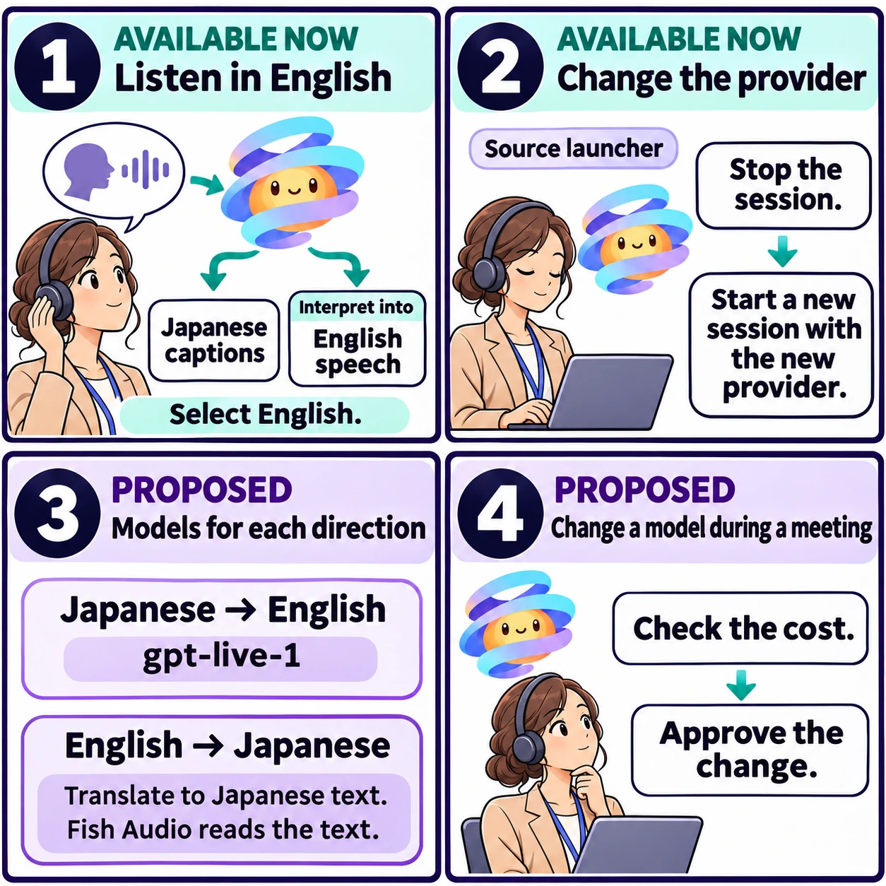

# Enny, the real-time meeting interpreter

This preview is a personal interpreter for a browser meeting. One listener runs Enny, selects the meeting tab, and hears English, Japanese, or Hindi in headphones. Other participants join normally and hear the original meeting.

| Choose a path | Who pays and when |
| --- | --- |
| **Try a sample** or **Start free rehearsal** | US$0. No account, card or API key. The sample works offline. |
| **Start live interpretation · billed by your own OpenAI account** | Get everyone’s consent. Set the session length and local cost limit. Review the estimate before confirming. When a live connection opens, OpenAI can bill the key owner, including during silence. Entering a key is free. Enny charges no fee. |

**Start here.** Download `meeting-interpreter.html`, open it in desktop Chrome, and select **Try a sample**. For spoken interpretation, use the desktop listener. Its one-hour local estimate for one listener is US$4.02. Your provider sets the final bill. [Preview downloads](https://github.com/LateralThinkingMachine/enny-interpreter/releases/tag/v0.1.0-preview.4) · [Browser file](standalone/meeting-interpreter.html) · [Illustrated setup guide](docs/get-started-with-enny.md)

**Inviting Enny for everyone.** The room-wide agent is a separate private test build. One organizer sets it up once and opens each meeting link in the agent browser. Other attendees need only their usual meeting client. The agent has an experimental live path for self-hosted Jitsi. Google Meet and Zoom meeting links have a free room check. For that private Jitsi test, one hour into one language has a US$3.00 local estimate for the whole room. The organizer’s OpenAI account pays after approval and connection. Attendee playback still needs verification on separate devices. This download provides the personal listener. [Public roadmap](https://github.com/orgs/LateralThinkingMachine/projects/1/views/1) · [Selected feature issues](https://github.com/LateralThinkingMachine/enny-roadmap/issues?q=is%3Aissue%20label%3Aroadmap)

## Enny’s model choices in four panels

Read each row from left to right. Panels 1 and 2 show features you can use now. Panels 3 and 4 show proposed features.

[](docs/assets/enny-model-choices.webp)

1. **Listen in English.** Before you start, select **English** under **Interpret into**. When a person speaks Japanese, Enny sends the audio to two OpenAI models. `gpt-live-transcribe` writes Japanese captions. `gpt-live-1` speaks the English interpretation in your headphones.

2. **Change the provider.** The desktop app uses OpenAI. The source launcher also supports the Google Gemini preview. Each session uses one provider.
   - If you want to keep your notes, select **Finish & export**. Otherwise, select **Stop**.
   - When the old connections close, exit the launcher.
   - Prepare a new profile for the new provider. Use that provider’s API key.
   - Check the estimated cost. If you accept it, start the new session.

   [Gemini setup for the source launcher](#gemini-fixed-target-source-preview)

3. **Models for each direction (proposed).** For Japanese to English, `gpt-live-1` would speak the English interpretation. For English to Japanese, Enny would first transcribe the English speech. Enny would then translate the text into Japanese. Fish Audio would read the Japanese text aloud. [Fish Audio text-to-speech](https://fish.audio/tts/)

4. **Change a model during a meeting (proposed).** At a pause, you would select a new model for one direction. Enny would show the estimated cost and the account that pays. It would identify the data the new provider would receive. If you approve, Enny would close the old connection. Only new speech would go to the new provider. If you decline, the new provider would receive nothing.

## Accounts and charges

| What you choose | What you need | Who bills you? |
| --- | --- | --- |
| Try the offline sample or rehearse locally | Just the download | Free. Neither Enny nor an AI provider charges for this mode. |
| Interpret live with your own key | A supported provider account and API key. Approve a live session. | Your provider bills the account that owns the key. Enny charges no fee. |
| Use the managed web interpreter (planned) | Create an account, configure a payment method, and approve paid use. | Lateral Thinking Machines will bill the purchaser for approved managed use. |
| Read the Enny–AtoposDB connection guide (planned) | A free Lateral Thinking Machines account once the portal opens. | Free. Reading the guide requires no card or paid plan. |
| Use managed AtoposDB (planned) | A signed-in account with access to a paid plan. An authorized buyer must confirm the purchase and payment must succeed. | Lateral Thinking Machines will bill the purchaser under the selected plan. |

The download offers free local use and live interpretation with your own provider key. Creating a customer account, saving a card or reading the guide authorizes no purchase. The planned managed web service will run on our infrastructure. An authorized buyer must purchase service and an organizer must approve the meeting before managed interpretation can incur usage.

## Where AtoposDB fits

**AtoposDB is a temporal graph database under construction.** It is designed to track relationships over time and distinguish when something happened from when the organization learned about it.

- **Self-hosting.** The public AtoposDB repository describes the design. To self-host, your team needs a separate engine build. Your team supplies the infrastructure, deploys the database, builds its own connection to Enny and its data sources, manages access, and runs updates and backups. Your team pays for that infrastructure and any provider usage. The Enny download contains the interpreter only.
- **Managed hosting.** Managed AtoposDB is planned as a paid service. Starting Enny or using your own OpenAI key does not activate it.
- **Connection walkthrough.** Anyone can read the public product overview. The detailed walkthrough will require a free customer account, with no card or subscription. There is no hosted account portal yet, so the walkthrough is omitted from the preview. [Public AtoposDB overview and development status](https://github.com/LateralThinkingMachine/atoposdb#development-status)

Imagine someone asks, **“Why are we still building this feature?”** Claude Meetings can answer questions using connected tools with permission. Enny’s proposed integration would link the question to the customer request, the engineering decision and the ticket still assigned to the team. [Claude Meetings overview](https://claude.com/resources/articles/claude-meetings)

| Question | What the evidence could show |
| --- | --- |
| What did the team believe three months ago? | The August 27 minutes and ticket called for nightly exports. |
| What did the team learn later about August? | An amendment effective August 20 called for exports every six hours. It entered the record on September 12. The minutes leave open who saw it in August. |
| What does the evidence support today? | The customer approved hourly exports in October. The ticket still says nightly. A deployment record would show what actually runs. |

In that example, an authorized coding agent such as Claude Code could inspect the cited decision and propose a change to the stale ticket. A person with permission to change the project would decide whether to proceed.

To explore the two dates now, open **Explore a fictional shipment correction** in the browser edition. Switch between the decision and correction times. This example runs entirely in the HTML file.

## Choose an edition

| Edition | What you can do | What you need |
| --- | --- | --- |
| Single HTML file | Try the offline sample or translate typed text. Experiment with local speech captions. | Desktop Chrome. Translation and speech require suitable browser language packs. |
| Full app | Check your audio locally, get original captions and hear spoken interpretation. Export your own captions and notes. | The macOS or Linux app, Chrome with tab-audio support, headphones and a key for live use. Rehearsal works without a key. |

The full app uses a local Rust service. Its interpreter and listener interfaces use Rust/UI components and Leptos compiled to WebAssembly. The browser handles tab selection and audio playback. The HTML edition embeds its Rust/WASM interface in a single file. [Platform and provider support](docs/interpretation-quality.md#provider-and-platform-support) · [UI component sources](apps/interpreter-ui/src/components/UPSTREAM.md)

The desktop preview supports Apple Silicon Macs on macOS 14 or later, and Linux on x86-64 or ARM64. Download an archive and its checksum manifest from the same release. [Desktop preview and checksums](https://github.com/LateralThinkingMachine/enny-interpreter/releases/tag/v0.1.0-preview.4) · [How to verify your download](SECURITY.md#verify-a-release-download)

## Build the full app from source

Start with macOS or desktop Linux, Git, Rustup, a C compiler and libclang. Install Node 25.6.1, pnpm 11.12.0, Python 3.10 or later, and desktop Chrome. On macOS, Xcode Command Line Tools supply the compiler and libclang.

```sh
git clone https://github.com/LateralThinkingMachine/enny-interpreter.git
cd enny-interpreter
rustup toolchain install 1.95.0
rustup target add wasm32-unknown-unknown --toolchain 1.95.0
rustup component add rust-docs --toolchain 1.95.0
cargo install --locked --version 0.2.130 wasm-bindgen-cli
pnpm install --frozen-lockfile
pnpm build
cargo build --locked -p meeting-call-pilot
python3 tools/local_call_pilot.py --open --duration-minutes 15
```

This starts a key-free rehearsal. On Linux, open the local sign-in page and select the private credentials file identified by the launcher. Confirm the audio check and share a meeting tab. The input meter should move when someone speaks. Press **Ctrl+C** in the terminal to end the rehearsal.

### Start live interpretation from source

Use headphones. Get each participant’s consent to send the selected audio to OpenAI. Confirm tab capture and the sound output. Read the [quality limits](docs/interpretation-quality.md#interpretation-quality-benchmark) before preparing a session.

In the checkout directory, create a private regular file named `.env` with mode `0600`. Use a local editor to put one line in the file, `OPENAI_API_KEY=your-own-key`. Keep the file out of Git. The following example authorizes two provider connections for up to 60 minutes with a US$5 local estimate limit.

```sh
mkdir -p -m 700 .interpreter-runtime
python3 tools/local_call_pilot.py \
  --prepare-activation "$PWD/.interpreter-runtime/meeting.json" \
  --duration-minutes 60 --budget-usd 5 --routes transcription,live \
  --live-modes interpretation --max-sessions 2 \
  --participant-consent --capture-routing-checked --headphones-checked \
  --quality-limitations-reviewed
python3 tools/local_call_pilot.py \
  --activate "$PWD/.interpreter-runtime/meeting.json" --open
```

Preparation does not start capture. Activate within 15 minutes. Choose your language. Review the estimated OpenAI cost and your local limit. Select **Start live interpretation · billed by your own OpenAI account**. Share the meeting tab with **Share tab audio** enabled. Select **Finish & export** to save your notes and original captions, or **Stop** to end the session immediately. Use a fresh profile filename for each subsequent session. Your provider determines the actual charge.

### Build a desktop launcher

The desktop launchers let a listener set a session length and cost limit before entering an API key. Build an archive from this checkout, then extract it on a supported computer. On an Apple Silicon Mac, run the Mac command. For Linux, install Docker and run the Linux command with `amd64` or `arm64`.

```sh
# Apple Silicon Mac
python3 tools/build_macos_release.py dist

# Linux x86-64
python3 tools/build_linux_release.py dist --arch amd64
```

The builders write archives and checksums into `dist/`. The Mac app uses an ad-hoc signature. Gatekeeper can block a downloaded copy. [Using your desktop launcher](docs/get-started-with-enny.md)

### Gemini fixed-target source preview

The source launcher also supports a Google preview. Prepare a separate finite profile with `--provider gemini`, `--routes transcription,live`, `--live-modes interpretation`, `--max-sessions 2` and a duration of up to ten minutes. Keep the Google key in a private `.env.gemini` file as `GEMINI_API_KEY=your-own-key`. Review Google's terms and obtain consent before sending audio. The destination is bound to the profile. [Provider details](docs/interpretation-quality.md#provider-and-platform-support)

## Preview limits

Attendee playback, reuse of the organizer installation across meetings, and provider shutdown at meeting end still need verification.

The macOS listener download is ad-hoc signed. Apple notarization and physical Linux audio testing remain open. Live Gemini availability, quality, and charges are unverified. [Platform and quality limits](docs/interpretation-quality.md#provider-and-platform-support)

## Verify the checkout

```sh
pnpm test
pnpm --filter @meeting/call-pilot lint
pnpm check:portable
cargo test --locked -p meeting-call-pilot
python3 tools/test_interpretation_benchmark.py
```

Use `pnpm build:portable` to regenerate the browser file after changing its source. Developers with Python Playwright and Chrome can run `python3 standalone/browser_smoke.py` for the browser edition and `python3 tools/test_browser_session.py` for the built full app. The optional OpenAI synthetic benchmark has a two-minute limit and a US$10 local estimate limit per run. [Benchmark instructions](docs/interpretation-quality.md#measure-a-live-route)

First-party interpreter code is licensed under Apache-2.0. [License](LICENSE) · [Third-party notices](THIRD_PARTY_NOTICES.md) · [Security and reporting](SECURITY.md)
