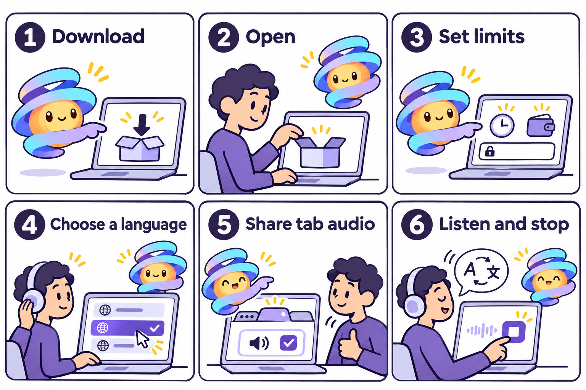

# Your first interpreted meeting with Enny

This download is for the person who wants to hear interpretation in headphones.

- **For everyone in the meeting:** The invited agent is a separate private test build. One organizer installs and configures it once. Once someone has joined the meeting, the organizer opens its link in the agent browser and admits **Enny**. Everyone else joins the usual meeting. They need no download, account, key, or card for Enny. The agent uses one output language for the room. Live testing is available on self-hosted Jitsi. Google Meet and Zoom allow a free room check. The room check has no Enny or OpenAI fee. Other meeting or hosting fees can apply.
- **For one listener:** Use the desktop preview and the steps below. Only the listener installs Enny. The listener hears the interpretation in headphones. Everyone else hears the original call.

Get everyone’s consent before live use. Approve the time and cost for each meeting. The key owner pays OpenAI when a live provider connection opens.

## 1. Get the app

Select the file for your computer. Download the checksum file. Check your download before opening it. [Download SHA256SUMS](https://github.com/LateralThinkingMachine/enny-interpreter/releases/download/v0.1.0-preview.5/SHA256SUMS) · [Check your download](../SECURITY.md#verify-a-release-download)

| Your computer | File to get |
| --- | --- |
| Mac with an Apple chip and macOS 14 or later | [Download the Mac ZIP](https://github.com/LateralThinkingMachine/enny-interpreter/releases/download/v0.1.0-preview.5/real-time-interpreter-macos-arm64.zip) |
| Linux PC with an Intel or AMD 64-bit processor | [Download the Linux x86-64 archive](https://github.com/LateralThinkingMachine/enny-interpreter/releases/download/v0.1.0-preview.5/real-time-interpreter-linux-amd64.tar.gz) |
| Linux computer with a 64-bit ARM processor | [Download the Linux ARM64 archive](https://github.com/LateralThinkingMachine/enny-interpreter/releases/download/v0.1.0-preview.5/real-time-interpreter-linux-arm64.tar.gz) |

On a Mac, **About This Mac** shows the chip and macOS version. The Enny window shows the installed build number. This preview is build 5. Linux requires Python 3.10 or later, glibc 2.36 or later, and system CA certificates.

## 2. Open the app

1. Connect your headphones.
2. Open the meeting in a Chrome tab.
3. Extract the downloaded file.
4. On a Mac, open the app in the extracted folder. The window shows **Enny**.
5. On Linux, open a terminal in the extracted folder.

If macOS blocks the app, download the browser file for a text sample. Open the saved file in desktop Chrome. Select **Try a sample**. The sample opens beside your captions. Select **Close sample** to hide it. [Download the browser file](https://github.com/LateralThinkingMachine/enny-interpreter/releases/download/v0.1.0-preview.5/meeting-interpreter.html)

**Optional sound check**

A rehearsal keeps the audio on your computer. It needs no provider key and incurs no provider charge.

1. On a Mac, select **Start free rehearsal**. On Linux, run `python3 start.py`. Use the local sign-in steps in section 3.
2. Ask everyone for permission to check the meeting audio.
3. Select **Everyone agrees to this local audio check.**
4. In Chrome, check that the price is **US$0.00**. Select **Start free rehearsal**.
5. Share the meeting tab with audio.
6. Watch the input meter while someone speaks.
7. Select **Release selected tab**.
8. End the rehearsal with **Stop session** on Mac or **Ctrl+C** on Linux.

## 3. Set limits

**OpenAI bills the account that owns the key.** If you use a company key, OpenAI bills that company’s OpenAI account. Enny charges no fee. Entering a key and opening Chrome are free. OpenAI can charge when the live speech connections open, even during silence.

Ask everyone for permission to send the selected audio to OpenAI. You need an OpenAI account that can use the speech models. Create an API key in your OpenAI account. Keep the key private. [OpenAI API keys](https://platform.openai.com/api-keys)

**For a one-hour meeting, use 60 minutes and a US$5.00 limit on each listener’s computer.**

The estimate for one listener is **US$4.02**. The **US$5.00** local limit controls the estimated use Enny can approve. You do not pay US$5.00 up front. OpenAI determines the final charge.

Choose a length from 1 to 60 whole minutes. Choose a cost limit of up to US$1,000. Include at most two digits after the decimal point. The launcher shows the minimum limit for your time. If your limit is too low, shorten the meeting or increase the limit.

| On a Mac | On Linux |
| --- | --- |
| Select **Start live interpretation · billed by your own OpenAI account**. | Run `python3 start.py --live` in the extracted folder. |
| Enter **60** in **Session length (minutes)**. | At the meeting length prompt, press **Enter** to use 60 minutes. |
| Enter **5.00** in **Local cost limit (US dollars)**. | At the cost prompt, press **Enter** to use US$5.00. |
| Review the estimate. | Review the time and cost shown in the terminal. |
| Enter your key in **OpenAI API key**. | Read each check in the terminal. |
| Check each box only if its statement is true. | Enter `y` only when each statement is true. |
| When all four are true, select **Approve and open**. | Check the estimate and the local limit. Enter `y` at the live start prompt to continue. |
| Chrome opens the operator page. | At the hidden key prompt, enter your own OpenAI key. |

**Linux local sign-in**

The credentials file opens the local operator controls. It does not create a customer account.

1. If Chrome does not open the sign-in page, open the `open-operator.html` file shown in the terminal.
2. Within two minutes, select the file under **Session credentials file**. Use the `credentials.json` path shown in the terminal.
3. If the sign-in expires, press **Ctrl+C**. Then start the launcher again.
4. Keep the terminal open during the meeting.

On either system, keep the operator tab private. Start audio within two minutes. If setup takes longer, the meeting has less time. The service uses the final ten seconds of a connection to close it.

## 4. Choose what to hear

If most speakers use one language, choose it under **Caption accuracy** → **Expected spoken language**. You can also enter names there to help with the original captions.

1. Under **Listen to**, select your audio source from the table.
2. Under **Interpret into**, select the language you want to hear.
3. Read the estimated OpenAI cost above the start button.
4. Check your local cost limit.
5. Select **Start live interpretation · billed by your own OpenAI account**.

| Audio source | What the app hears | Next step |
| --- | --- | --- |
| **Meeting tab · other people** | Other voices in the meeting tab | Go to section 5. |
| **My microphone · my voice** | Your selected microphone only | When Chrome asks, select **Allow**. Wait for **Listening**. Go to section 6. |

## 5. Share the meeting tab

1. In the Chrome sharing window, select the tab that contains the meeting.
2. Turn on **Share tab audio**.
3. Select **Share**.
4. Wait for **Listening**.

## 6. Check the words and finish

OpenAI creates captions in the original language. A second connection interprets the same audio into your chosen language. You hear the result in your headphones. Other participants keep hearing the ordinary meeting. Enny does not join the call.

1. For tab audio, ask another participant to speak. For microphone audio, say a short sentence.
2. Listen for the interpretation in your headphones.
3. Confirm important names, dates, and quantities with the speaker.

If you hear nothing, check your headphones. For tab audio, check **Share tab audio**. For microphone audio, check Chrome’s microphone permission. If the app shows **Enable interpretation sound**, select it.

To keep the original captions and notes, select **Finish & export**. Wait for Chrome to download `private-call-pilot-notes.txt` before you close the app.

To end immediately and discard unsaved work, select **Stop**. On a Mac, close the local service with **Stop session**. On Linux, press **Ctrl+C** in the terminal.

When a live session ends, read the message in the launcher.

- If Enny admitted no provider work, this run started no paid work.
- If OpenAI confirmed closure for every admitted connection, check your OpenAI account for the final charge.
- If closure is unconfirmed, local audio has stopped. Check usage in your OpenAI account.

## What could a one-hour meeting cost with the desktop listener?

Suppose six people speak three languages. If only the organizer wants interpretation, one download and one running copy cover that listener. The other five join normally. Each additional person who wants private interpretation runs their own copy. The OpenAI account that owns each key pays for that copy. Enny adds no fee.

| Who uses interpretation for the full hour? | Estimated total, US dollars |
| --- | ---: |
| One listener on one computer | $4.02 |
| Three listeners, one per language, on three computers | $12.06 |
| All six listeners on separate computers | $24.12 |

OpenAI rates checked on 27 November 2026. These examples allow 60 minutes of active interpretation and 60 minutes of original captions per computer. Active interpretation costs $0.050 per minute. Captions cost $0.017 per audio minute. For one listener, 60 × ($0.050 + $0.017) = $4.02. Actual charges depend on use and provider rates. [OpenAI interpretation rate](https://developers.openai.com/api/docs/models/gpt-live-1) · [OpenAI caption rate](https://developers.openai.com/api/docs/models/gpt-live-transcribe)

For a shorter meeting, 10 minutes costs about $0.67 per computer. The minimum local limit for one hour is $4.02 per computer. The local limit applies only to this session on this computer.
